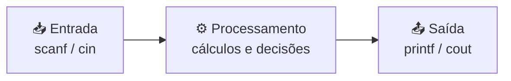
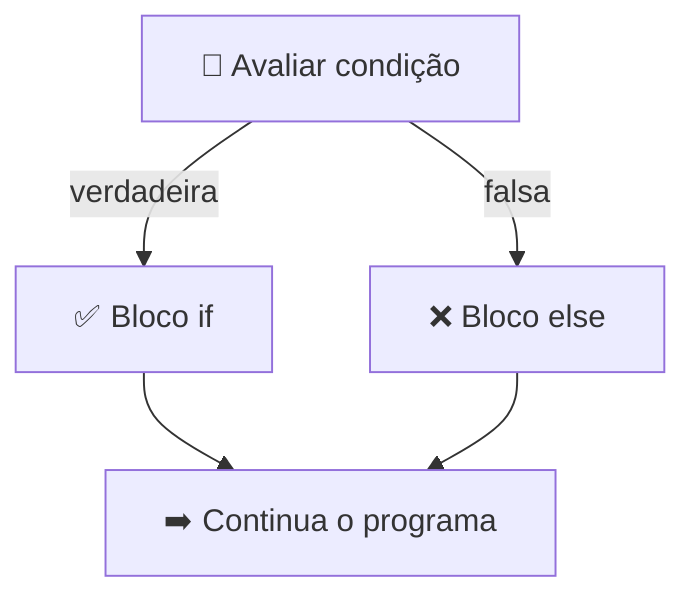

# 🔀 Aula 02 — Revisão de Lógica e Estruturas Condicionais

A aula retoma os fundamentos da lógica de programação — entrada, processamento e saída, variáveis, operadores e teste de mesa — e introduz as **estruturas condicionais** (`if` / `else`) para tomada de decisão em C++.

> **Disciplina:** Estrutura de Dados  
> **Tema:** Revisão de lógica, operadores e condicionais

---

## 🎯 Objetivos da aula

- 🔄 Revisar o fluxo entrada → processamento → saída;
- 🧮 Aplicar operadores aritméticos, relacionais e lógicos;
- 🧪 Executar **teste de mesa** para validar algoritmos;
- 🔀 Escrever decisões com `if`, `else` e `else if`.

---

## 🗺️ Mapa mental da aula

```text
                    🔀 Lógica e Condicionais
                              │
        ┌─────────────┬───────┴────────┬──────────────┐
        │             │                │              │
   🧠 Conceitos   🧮 Operadores    🧪 Teste de     🔀 Decisão
        │             │             mesa            │
   Variáveis      Aritméticos     Passo a passo   if / else
   Memória        Atribuição      Valores         else if
   E/S            Lógicos         Verificação     Desafios
```

---

## 🧭 Fluxo de um algoritmo



Todo algoritmo pode ser descrito em três fases: **entrada** dos dados, **processamento** e **saída** do resultado. O **teste de mesa** simula esse percurso manualmente, acompanhando o valor de cada variável.

---

## 🔀 Estruturas condicionais



| Estrutura | Quando usar |
|---|---|
| `if` | Uma única condição verdadeira. |
| `if / else` | Dois caminhos possíveis. |
| `if / else if / else` | Três ou mais faixas de decisão. |
| `&&`, `\|\|`, `!` | Combinar ou inverter condições. |

---

## 📂 Materiais disponíveis

| Arquivo | O que apresenta |
|---|---|
| [📝 resumoAula02.md](resumoAula02.md) | Resumo completo: operadores, teste de mesa, condicionais, operadores lógicos e desafio. |
| [💻 atividade01.cpp](atividade01.cpp) | Verificação de maioridade a partir da idade informada. |
| [💻 atividade02.cpp](atividade02.cpp) | Verifica se um número está no intervalo de 10 a 20. |
| [💻 desafio.cpp](desafio.cpp) | Classifica um número como positivo, negativo ou zero. |

---

## 📝 Atividade da aula

Ler valores pelo teclado e aplicar decisões com `if/else`, documentando o **teste de mesa** de cada exercício no resumo da aula.

---

## 📚 Referências

- DEITEL, H. M.; DEITEL, P. J. *C++: Como Programar*. 6. ed. Pearson, 2011.
- [C++ Reference — Statements](https://en.cppreference.com/w/cpp/language/statements)

---

[← Aula 01](../Aula%2001%20%E2%80%94%20Introdu%C3%A7%C3%A3o%20%C3%A0%20Estrutura%20de%20Dados/README.md) · [📚 Índice da disciplina](../README.md) · [Aula 03 →](../Aula%2003%20%E2%80%94%20Condicionais,%20Switch-Case%20e%20Operador%20Tern%C3%A1rio/README.md)
