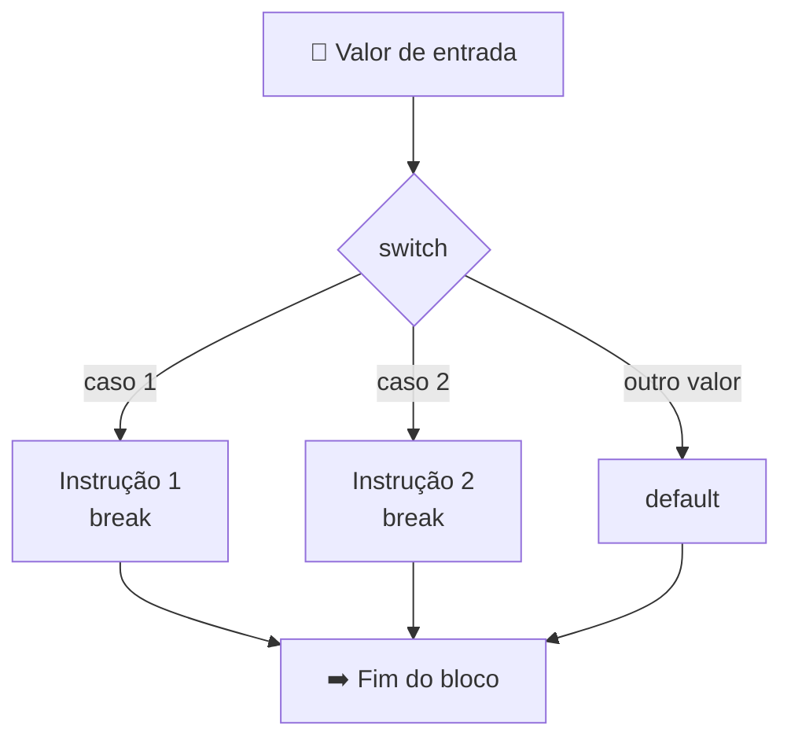

# 🎛️ Aula 03 — Condicionais, Switch-Case e Operador Ternário

A aula aprofunda a tomada de decisão: compara `if/else` encadeado com `switch/case`, apresenta o **operador ternário** e explora operadores lógicos em desafios de classificação (triângulos, paridade, vogais, faixas de imposto).

> **Disciplina:** Estrutura de Dados  
> **Tema:** `switch/case`, operador ternário e operadores lógicos

---

## 🎯 Objetivos da aula

- 🎛️ Escolher entre `if/else` encadeado e `switch/case`;
- ⚡ Simplificar decisões simples com o operador ternário;
- 🧠 Combinar condições com `&&`, `||` e `!`;
- 🧪 Resolver desafios de classificação e validação.

---

## 🗺️ Mapa mental da aula

```text
                     🎛️ Estruturas de decisão
                                │
        ┌──────────────┬────────┴────────┬───────────────┐
        │              │                 │               │
   🔀 if / else    🎛️ switch/case    ⚡ Ternário     🧠 Lógicos
        │              │                 │               │
   Encadeado       Múltiplos casos    cond ? a : b    E / OU / NÃO
   Faixas          break padrão        Expressões     Combinações
```

---

## 🎛️ `switch/case` × `if/else`



| Estrutura | Melhor para |
|---|---|
| `if/else` encadeado | Faixas de valores e condições compostas (`>=`, `&&`). |
| `switch/case` | Valores discretos e muitos casos (dias, opções de menu). |
| Ternário `? :` | Decisões curtas, como par/ímpar ou aprovado/reprovado. |

> ⚠️ No `switch`, o `break` encerra o caso; sem ele, a execução "cai" no caso seguinte (*fall-through*).

---

## 📂 Materiais disponíveis

| Arquivo | O que apresenta |
|---|---|
| [📝 resumoAula03.md](resumoAula03.md) | Resumo da aula: variáveis, operadores, decisão, `switch/case` e ternário. |
| [💻 atividade01.cpp](atividade01.cpp) | Dia da semana com `if/else` encadeado. |
| [💻 atividade02.cpp](atividade02.cpp) | Mesmo problema resolvido com `switch/case`. |
| [💻 atividade03ternario.cpp](atividade03ternario.cpp) | Par ou ímpar com operador ternário. |
| [💻 desafio01ifElse.cpp](desafio01ifElse.cpp) | Menu de matérias do curso com `if/else`. |
| [💻 desafio01switchCase.cpp](desafio01switchCase.cpp) | Mesmo menu com `switch/case`. |
| [💻 desafio02.cpp](desafio02.cpp) | Situação do aluno pela nota. |
| [💻 desafio03.cpp](desafio03.cpp) | Classificação de triângulos pelos lados. |
| [💻 desafio04.cpp](desafio04.cpp) | Faixas de desconto de imposto de renda. |
| [💻 desafio05.cpp](desafio05.cpp) | Par ou ímpar com `if/else`. |
| [💻 desafio06.cpp](desafio06.cpp) | Vogal ou consoante. |

---

## 📝 Atividade da aula

Resolver o mesmo problema com `if/else` e com `switch/case`, comparando legibilidade e escolhendo a estrutura mais adequada para cada situação.

---

## 📚 Referências

- DEITEL, H. M.; DEITEL, P. J. *C++: Como Programar*. 6. ed. Pearson, 2011.
- [C++ Reference — switch](https://en.cppreference.com/w/cpp/language/switch)

---

[← Aula 02](../Aula%2002%20%E2%80%94%20Revis%C3%A3o%20de%20L%C3%B3gica%20e%20Estruturas%20Condicionais/README.md) · [📚 Índice da disciplina](../README.md) · [Aula 04 →](../Aula%2004%20%E2%80%94%20Fun%C3%A7%C3%B5es%20com%20e%20sem%20Retorno/README.md)
