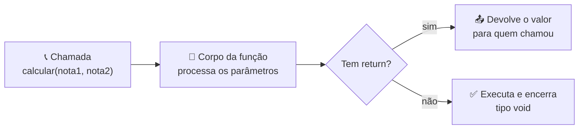

# 🧩 Aula 04 — Funções com e sem Retorno

A aula introduz a **modularização**: dividir o programa em funções que recebem parâmetros, executam um bloco de código e podem (ou não) devolver um resultado. Os exercícios aplicam funções ao cálculo de média, tabuada e potência.

> **Disciplina:** Estrutura de Dados  
> **Tema:** Funções, parâmetros e retorno

---

## 🎯 Objetivos da aula

- 🧩 Entender por que dividir o código em funções;
- 📥 Declarar parâmetros e 📤 retornar valores;
- 🔁 Reutilizar funções em diferentes partes do programa;
- 🧮 Aplicar funções a cálculos de média, tabuada e cubo.

---

## 🗺️ Mapa mental da aula

```text
                        🧩 Funções
                            │
        ┌──────────────┬────┴─────────┬──────────────┐
        │              │              │              │
   📥 Parâmetros  📤 Retorno     🔁 Reuso      🧮 Aplicação
        │              │              │              │
   Entrada        return        Chamadas      Média
   Tipos          void          Modularização Tabuada
   Valores        Resultado     Organização   Cubo
```

---

## 🔄 Ciclo de uma função



| Tipo | Característica | Exemplo no repositório |
|---|---|---|
| **Com retorno** | Devolve um valor com `return` | `fcubo()`, `fmult()`, `fsoma()` |
| **Sem retorno** | Executa uma ação e termina (`void`) | `ftabuada()`, `fsub()` |

---

## 🧠 Boas práticas

- Dar nomes claros às funções (verbo + objeto: `calcularMedia`, `exibirTabuada`);
- Manter cada função com **uma responsabilidade**;
- Evitar variáveis globais quando o parâmetro resolve;
- Declarar a função **antes** de usá-la ou usar protótipo.

---

## 📂 Materiais disponíveis

| Arquivo | O que apresenta |
|---|---|
| [💻 atividade01.cpp](atividade01.cpp) | Cálculo de média com P1, P2 e ATV e verificação de aprovação. |
| [💻 atividade02.cpp](atividade02.cpp) | Funções `ftabuada()` e `fcubo()` aplicadas a um número. |
| [💻 tarefa.cpp](tarefa.cpp) | Média com função `fsub()` para a prova substitutiva. |

---

## 📝 Atividade da aula

Transformar os exercícios das aulas anteriores em funções, separando **entrada**, **processamento** e **saída**, e reutilizando as mesmas funções em mais de um programa.

---

## 📚 Referências

- DEITEL, H. M.; DEITEL, P. J. *C++: Como Programar*. 6. ed. Pearson, 2011.
- [C++ Reference — Functions](https://en.cppreference.com/w/cpp/language/functions)

---

[← Aula 03](../Aula%2003%20%E2%80%94%20Condicionais,%20Switch-Case%20e%20Operador%20Tern%C3%A1rio/README.md) · [📚 Índice da disciplina](../README.md) · [Aula 05 →](../Aula%2005%20%E2%80%94%20Fun%C3%A7%C3%B5es,%20Vetores%20e%20Sistema%20de%20Vendas/README.md)
