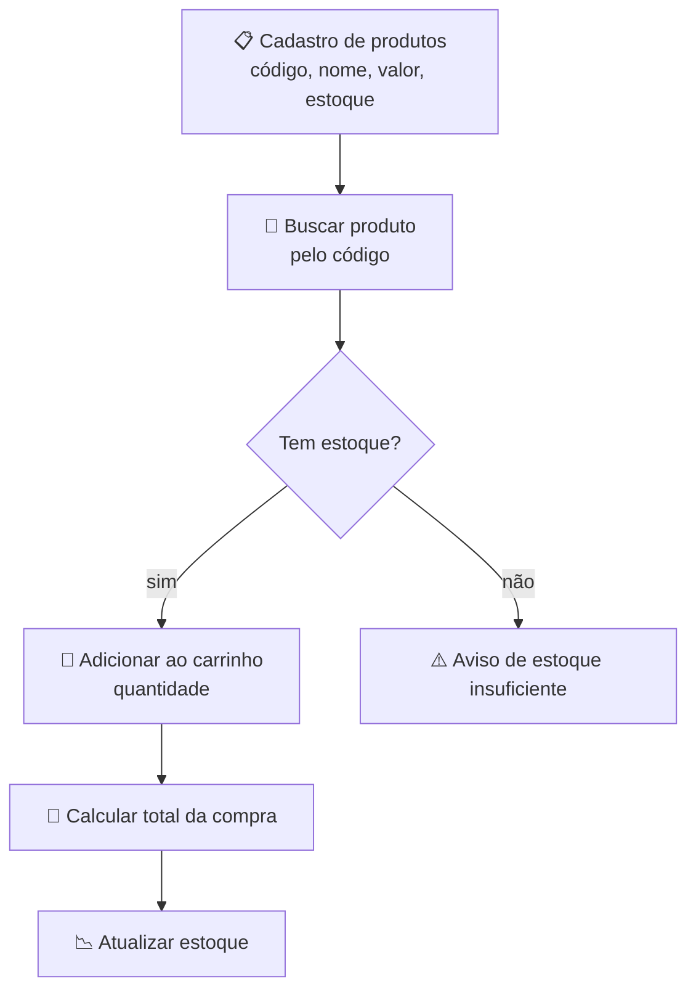

# 🛒 Aula 05 — Funções, Vetores e Sistema de Vendas

A aula combina **funções com passagem de parâmetros** e **vetores** em um sistema de vendas completo: cadastro de produtos, controle de estoque, carrinho de compras e totalização. É o primeiro exercício com vários dados relacionados.

> **Disciplina:** Estrutura de Dados  
> **Tema:** Funções com parâmetros, vetores e sistema de vendas

---

## 🎯 Objetivos da aula

- 📥 Passar vetores e variáveis como parâmetros para funções;
- 🗃️ Armazenar dados relacionados em vetores paralelos;
- 🔁 Percorrer vetores com laços de repetição;
- 🛒 Simular um fluxo de vendas com estoque e carrinho.

---

## 🗺️ Mapa mental da aula

```text
                  🛒 Funções + Vetores
                           │
        ┌─────────────┬────┴─────────┬──────────────┐
        │             │              │              │
   🧩 Funções     🗃️ Vetores     🔁 Laços      🛒 Vendas
        │             │              │              │
   Parâmetros     Código[]       for / while     Estoque
   Retorno        Nome[][]       Busca           Carrinho
   Escopo         Valor[]        Soma            Total
```

---

## 🔄 Fluxo do sistema de vendas



| Vetor | Guarda |
|---|---|
| `codigo[]` | Código de cada produto |
| `nome[][30]` | Nome do produto (matriz de caracteres) |
| `valor[]` | Preço unitário |
| `estoque[]` | Quantidade disponível |

Vetores **paralelos** compartilham o mesmo índice: `nome[3]` descreve o produto cujo `codigo[3]` e `valor[3]` estão na mesma posição.

---

## 📂 Materiais disponíveis

| Arquivo | O que apresenta |
|---|---|
| [💻 atividade01.cpp](atividade01.cpp) | Funções `fsoma()`, `fmult()` e `fcubo()` encadeadas sobre um número. |
| [💻 tarefa.cpp](tarefa.cpp) | Sistema de vendas com cadastro, carrinho, total e baixa de estoque. |
| [💻 tarefa_edit_em_aula.cpp](tarefa_edit_em_aula.cpp) | Versão do sistema ajustada durante a aula. |

---

## 📝 Atividade da aula

Implementar um sistema de vendas com vetores paralelos e funções separadas para **cadastrar**, **buscar**, **vender** e **exibir** os produtos, tratando estoque insuficiente.

---

## 📚 Referências

- DEITEL, H. M.; DEITEL, P. J. *C++: Como Programar*. 6. ed. Pearson, 2011.
- [C++ Reference — Arrays](https://en.cppreference.com/w/cpp/language/array)

---

[← Aula 04](../Aula%2004%20%E2%80%94%20Fun%C3%A7%C3%B5es%20com%20e%20sem%20Retorno/README.md) · [📚 Índice da disciplina](../README.md) · [Aula 06 →](../Aula%2006%20%E2%80%94%20Bibliotecas,%20Vetores%20e%20Matrizes/README.md)
