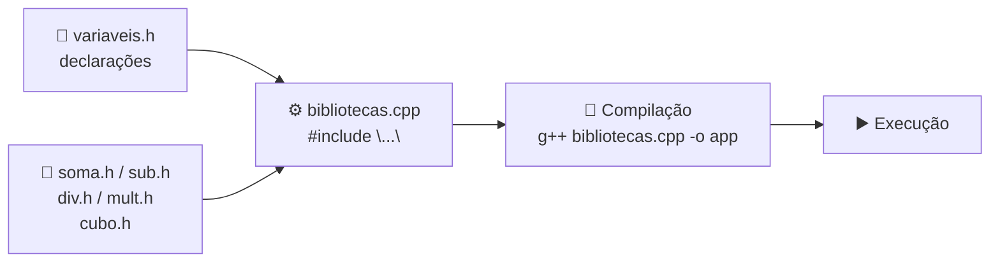
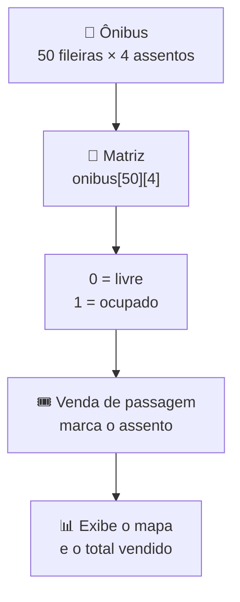

# 📚 Aula 06 — Bibliotecas, Vetores e Matrizes

A aula mostra como criar **bibliotecas próprias** (arquivos `.h` com declarações e `.cpp` com implementações) e aplica **matrizes** na simulação do mapa de assentos de um ônibus.

> **Disciplina:** Estrutura de Dados  
> **Tema:** Headers, modularização, vetores e matrizes

---

## 🎯 Objetivos da aula

- 📚 Separar declaração (`.h`) e implementação (`.cpp`);
- 🔗 Incluir bibliotecas próprias com `#include "arquivo.h"`;
- 🗺️ Representar dados em **matrizes** (linhas × colunas);
- 🧩 Organizar um projeto em múltiplos arquivos.

---

## 🗺️ Mapa mental da aula

```text
              📚 Bibliotecas + Matrizes
                         │
        ┌────────────┬───┴──────────┬─────────────┐
        │            │              │             │
   📄 Headers   🧩 Módulos     🗃️ Vetores    🗺️ Matrizes
        │            │              │             │
   .h declara   .cpp implementa  Lista 1D     Linhas × colunas
   Guardas      Compilação       Índice       Assentos
```

---

## 🔗 Como uma biblioteca própria funciona



| Arquivo | Papel |
|---|---|
| `variaveis.h` | Variáveis compartilhadas |
| `soma.h`, `sub.h`, `div.h`, `mult.h`, `cubo.h` | Operações da calculadora |
| `bibliotecas.cpp` | Programa principal que reúne as bibliotecas |

---

## 🗺️ Matriz no controle de assentos



O programa do ônibus usa uma matriz `int onibus[50][4]` para representar os assentos, com funções para **inicializar**, **exibir**, **vender** e **calcular** o total arrecadado.

---

## 📂 Materiais disponíveis

| Arquivo | O que apresenta |
|---|---|
| [📄 variaveis.h](atividadeBibliotecas/variaveis.h) | Variáveis globais da calculadora. |
| [📄 soma.h](atividadeBibliotecas/soma.h) · [sub.h](atividadeBibliotecas/sub.h) · [div.h](atividadeBibliotecas/div.h) · [mult.h](atividadeBibliotecas/mult.h) · [cubo.h](atividadeBibliotecas/cubo.h) | Declarações das operações. |
| [💻 bibliotecas.cpp](atividadeBibliotecas/bibliotecas.cpp) | Programa que inclui e testa as bibliotecas. |
| [💻 onibus.h](atividadeOnibus/onibus.h) · [onibus.cpp](atividadeOnibus/onibus.cpp) | Funções do sistema de ônibus. |
| [💻 main.cpp](atividadeOnibus/main.cpp) | Menu e execução do sistema de assentos. |
| [🗂️ sistema_onibus.dev](atividadeOnibus/sistema_onibus.dev) | Arquivo de projeto da IDE Dev-C++. |

---

## 📝 Atividade da aula

Criar uma biblioteca própria com funções matemáticas e um programa que a utilize; depois, implementar o mapa de assentos do ônibus com matriz e funções de venda.

---

## 📚 Referências

- DEITEL, H. M.; DEITEL, P. J. *C++: Como Programar*. 6. ed. Pearson, 2011.
- [C++ Reference — Headers](https://en.cppreference.com/w/cpp/header)

---

[← Aula 05](../Aula%2005%20%E2%80%94%20Fun%C3%A7%C3%B5es,%20Vetores%20e%20Sistema%20de%20Vendas/README.md) · [📚 Índice da disciplina](../README.md) · [Aula 07 →](../Aula%2007%20%E2%80%94%20Manipula%C3%A7%C3%A3o%20de%20Strings/README.md)
