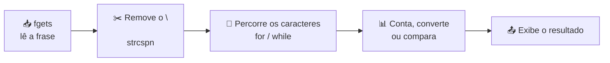

# 🔤 Aula 07 — Manipulação de Strings

A aula trabalha **cadeias de caracteres** em C/C++: leitura com `fgets`, remoção do `\n`, percurso com laços e uso de funções da biblioteca `<string.h>` / `<ctype.h>` para contar, converter e comparar texto.

> **Disciplina:** Estrutura de Dados  
> **Tema:** Strings, vetores de caracteres e funções de texto

---

## 🎯 Objetivos da aula

- 🔤 Entender strings como vetores de `char` terminados em `\0`;
- 📥 Ler frases com espaços usando `fgets`;
- 🔁 Percorrer caracteres com laços de repetição;
- 🛠️ Usar `strlen`, `strcspn`, `toupper`, `tolower` e comparações.

---

## 🗺️ Mapa mental da aula

```text
                    🔤 Strings
                        │
        ┌───────────┬───┴────────┬────────────┐
        │           │            │            │
   📥 Leitura   🔁 Percurso   🛠️ Funções   🔍 Análise
        │           │            │            │
   fgets       for / while    strlen       Contar
   gets (evitar) char[]       strcmp       Converter
   Buffer      '\0'           ctype.h      Comparar
```

---

## 🔁 Pipeline de processamento de uma frase



| Função | Para que serve |
|---|---|
| `fgets(buffer, tamanho, stdin)` | Ler uma linha com espaços com segurança. |
| `strcspn(frase, "\n")` | Encontrar a posição do `\n` para removê-lo. |
| `strlen(frase)` | Obter o tamanho da string. |
| `toupper()` / `tolower()` | Converter maiúsculas e minúsculas. |
| `strcmp(a, b)` | Comparar duas strings. |

---

## 📂 Materiais disponíveis

| Arquivo | O que apresenta |
|---|---|
| [💻 atividade01_completa.cpp](atividade01_completa.cpp) | Programa com menu: inserir frase, contar caracteres, converter e analisar o texto. |

---

## 📝 Atividade da aula

Ler uma frase completa, remover o caractere de quebra de linha e implementar funções de **contagem de caracteres**, **conversão de caixa** e **comparação**, sem usar `gets`.

---

## 📚 Referências

- DEITEL, H. M.; DEITEL, P. J. *C++: Como Programar*. 6. ed. Pearson, 2011.
- [C++ Reference — Null-terminated strings](https://en.cppreference.com/w/cpp/string/byte)

---

[← Aula 06](../Aula%2006%20%E2%80%94%20Bibliotecas,%20Vetores%20e%20Matrizes/README.md) · [📚 Índice da disciplina](../README.md) · [Aula 08 →](../Aula%2008%20%E2%80%94%20Vetores%20e%20Listas/README.md)
