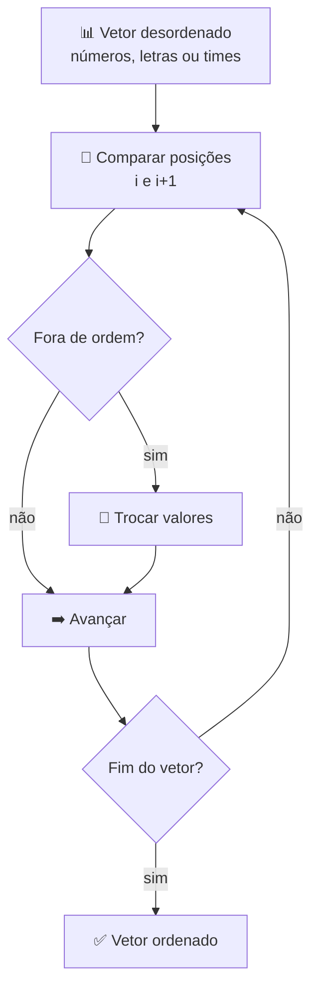

# 📊 Aula 08 — Vetores e Listas

A aula consolida o uso de **vetores**: armazenamento de vários valores, percursos com laços, ordenação e exibição. Os exercícios incluem listas de números, letras e uma tabela de classificação de times.

> **Disciplina:** Estrutura de Dados  
> **Tema:** Vetores, ordenação e listas

---

## 🎯 Objetivos da aula

- 📊 Declarar e inicializar vetores;
- 🔁 Percorrer posições com `for`;
- 🔃 Ordenar valores dentro do vetor;
- 🏆 Relacionar vetores paralelos em uma lista (times, pontos e gols).

---

## 🗺️ Mapa mental da aula

```text
                      📊 Vetores
                          │
        ┌────────────┬────┴─────────┬────────────┐
        │            │              │            │
   📥 Inserir   🔁 Percorrer    🔃 Ordenar   🏆 Listas
        │            │              │            │
   Leitura      for / while     Troca       Times
   Posição      Exibição        Comparação  Pontos
   Índice       Busca           Ordem       Gols
```

---

## 🔃 Fluxo de ordenação



| Estrutura | Uso no exercício |
|---|---|
| `int numero[13]` | Lista de números inteiros |
| `char letra[13]` | Lista de caracteres |
| `time[12][30]` | Nomes dos times |
| `pontos[12]`, `gols[12]` | Vetores paralelos com a pontuação |

---

## 📂 Materiais disponíveis

| Arquivo | O que apresenta |
|---|---|
| [💻 atividade01.cpp](atividade01.cpp) | Inserção e exibição de números em um vetor. |
| [💻 atividade02.cpp](atividade02.cpp) | Versão com letras e percurso do vetor. |
| [💻 atividade03.cpp](atividade03.cpp) | Ordenação dos valores do vetor. |
| [💻 lista_futebol.cpp](lista_futebol.cpp) | Tabela de times com pontos e gols em vetores paralelos. |

---

## 📝 Atividade da aula

Criar um programa que leia valores para um vetor, exiba os dados na ordem original e depois **ordenados**, usando funções para separar inserção, exibição e ordenação.

---

## 📚 Referências

- DEITEL, H. M.; DEITEL, P. J. *C++: Como Programar*. 6. ed. Pearson, 2011.
- [C++ Reference — std::array](https://en.cppreference.com/w/cpp/container/array)

---

[← Aula 07](../Aula%2007%20%E2%80%94%20Manipula%C3%A7%C3%A3o%20de%20Strings/README.md) · [📚 Índice da disciplina](../README.md) · [Aula 09 →](../Aula%2009%20%E2%80%94%20Structs/README.md)
