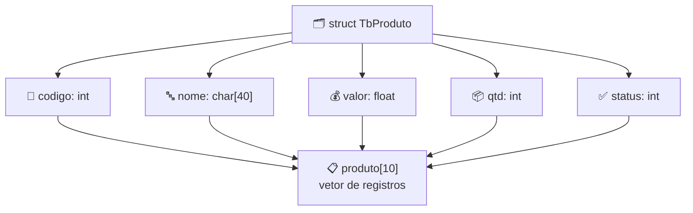

# 🗂️ Aula 09 — Structs

A aula apresenta **structs**: agrupar campos de tipos diferentes em um único registro. Os exercícios simulam cadastros de clientes e de produtos, com inserção, listagem e busca em vetores de `struct`.

> **Disciplina:** Estrutura de Dados  
> **Tema:** Registros (`struct`), vetores de structs e cadastros

---

## 🎯 Objetivos da aula

- 🗂️ Declarar `struct` com campos de tipos diferentes;
- 🧱 Criar vetores de `struct` para vários registros;
- 📋 Implementar inserção, listagem e busca;
- 🔗 Relacionar registros com funções.

---

## 🗺️ Mapa mental da aula

```text
                      🗂️ Structs
                          │
        ┌────────────┬────┴─────────┬────────────┐
        │            │              │            │
   🧱 Definição  📋 Registros   🔎 Busca     💾 Vetores
        │            │              │            │
   Campos       Cadastro       Por código   struct[10]
   Tipos        Listagem       Por nome     Índice
   struct       Menu           Comparação   Posição
```

---

## 🧱 Estrutura de um registro



| Struct | Campos |
|---|---|
| `TbFicha` | `codigo`, `nome`, `bairro`, `cidade`, `telefone`, `rg`, `cpf` |
| `TbProduto` | `codigo`, `nome`, `valor`, `qtd`, `status` |

Cada posição do vetor (`ficha[0]`, `produto[3]`…) guarda **todos os campos** de um registro, acessados com ponto: `produto[i].nome`.

---

## 📂 Materiais disponíveis

| Arquivo | O que apresenta |
|---|---|
| [💻 atividade01.cpp](atividade01.cpp) | Cadastro de clientes com `struct TbFicha`, inserção e listagem. |
| [💻 atividade02.cpp](atividade02.cpp) | Cadastro de produtos com `struct TbProduto`, valor, quantidade e status. |

---

## 📝 Atividade da aula

Criar um cadastro com `struct` e vetor de registros, incluindo menu com **inserir**, **listar** e **buscar** por código, mantendo as operações em funções separadas.

---

## 📚 Referências

- DEITEL, H. M.; DEITEL, P. J. *C++: Como Programar*. 6. ed. Pearson, 2011.
- [C++ Reference — Classes and structs](https://en.cppreference.com/w/cpp/language/class)

---

[← Aula 08](../Aula%2008%20%E2%80%94%20Vetores%20e%20Listas/README.md) · [📚 Índice da disciplina](../README.md)
